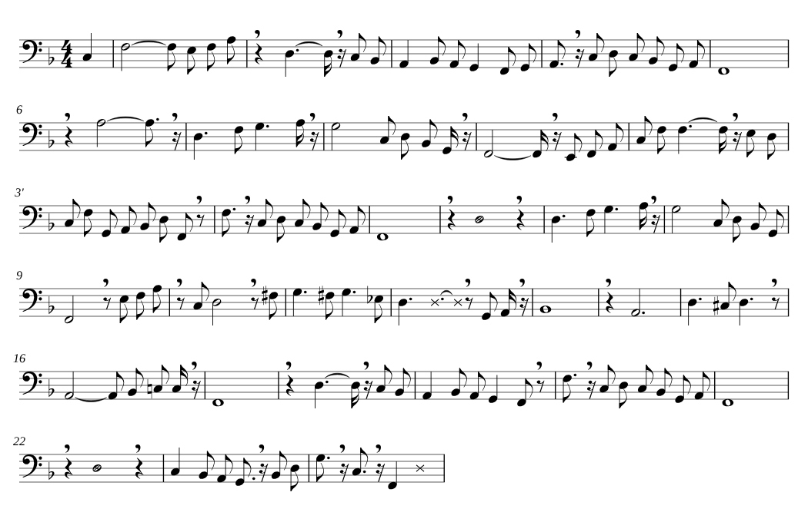

# Träumerei, hummed

The melody of Alfred Grünfeld's 1905 Welte-Mignon recording of Schumann's *Träumerei*
(roll 225), sung back by the voice synthesisers available in 2026. Every version takes its
onsets, note ends and dynamics from the MPM reconstruction published at
<https://welte225.org/mpm/>; what differs is only the voice. The research question behind
it — can any AI model imitate human humming or singing perfectly when told exactly when which
pitch should sound? — is answered in `report/`.

Listening page (all versions, with the pitch of each drawn over Grünfeld's notes):
<https://claude.ai/artifact/MXu7DCSHuaA8r5Z8MibiRC> (private until shared from its Share menu).

## Contents

| Path | What it is |
|---|---|
| `report/AI humming synthesis from scores.md` | the research report |
| `report/notes/` | the notes it was written from: four literature surveys and the experiment record |
| `scripts/` | everything that produced the renderings, in the order below |
| `data/melody.json` | the 162 melody notes as Grünfeld plays them, the MPM dynamics curve and the sustain pedal |
| `data/analysis.json` | per version: pitch accuracy, onset arrival, dynamics correlation |
| `data/versions.json` | per version: how it was made and what it takes from the roll |
| `reduction/` | what the live voice hums: a reduction for a pianist's bass voice, as MEI, and the scripts around it |
| `live/` | the live page: worker, hummer, VocalTractLab engine, static data, build and calibration |

The scripts regenerate the audio of every version. The published page now holds only the hum:
its spectrogram, scrolling under a playhead, mixed live against the piano roll with two faders
(`scripts/mix_page.html`, with the tiles from `spectrogram_tiles.py`).

## Grünfeld hums along: a vocal map inside the MPM

`data/performance_hummed.mpm` is the reconstruction with one more map in its global `<dated>`
section: a `<vocalMap>`, dated in ticks like the other maps, so the voice follows Grünfeld's
tempo and rubato through the same date-to-time mapping as the piano. Its events are `pitch`
(naming the note it sings; a `portamento.ref` names the `<ornament>` whose arpeggio span the
slide takes), `posture` (a closed-hum shape, the open shape it leans toward, an `amount` and a
`transitionMs`), `velum`, `pressure` (factors shaping the voice's effort: a swell into each
phrase, a release at its end), `articulation` (breath pulses and stops between notes), `lips`
(an "m" into a detached note where the mouth is open), `inflection` (scoops into phrases,
falls at their ends) and `breath`. The header's `<vocalStyles>` say how the voice does things:
synthesiser, transposition, time constants, wobble, how the effort follows the dynamics
(`<effortDef>`), and the posture shapes (fitted, like the
inflection sizes in `data/profile.json`, from a recorded hum). This is a proposal, not part of
the MPM standard; espressivo ignores the map, and the piano renders identically with it.

`scripts/hummer/hummer.py` writes the map from the performance (rules in its docstring) and
converts it to a VocalTractLab gestural score (`data/performance_hummed.ges`; the speaker file
it needs, VocalTractLab's JD3 with the postures and the steps of each transition added, is written
by `run_hummer.py`); `run_hummer.py` renders it in phrase chunks and calibrates each note's lung
pressure once from the measured note levels (a rendering correction, not part of the map). `profile.py` and `step1`–`step5_ges.py` are the
analysis-by-synthesis of the recorded hum that the style comes from (the recording itself is not
in this repository).

The dynamics are not copied into the map. `<effortDef source="dynamicsMap">` says that the
voice's effort follows the performance's own dynamicsMap, as espressivo renders it below the
note level (`subNoteDynamics`, the curve in `data/melody.json`), plus each note's own velocity
offset from it (metrical accents, articulations): lung pressure with velocity^1.5 and the glottis
from breathy (velocity 33) to modal (48), which together make the hum's level follow the MIDI
convention of 40 log10 velocity. So the hum swells and fades inside held notes, which the piano
cannot: on notes where the curve moves, the voice's level change follows it at r = 0.71 (0.16
when pressure was set once per note).

Articulation follows the fingers: the time Grünfeld's keys leave between two melody notes, as
espressivo renders the articulationMap, is the time the voice leaves. Where the keys overlap by
more than 30 ms, the voice slides into the next note over half the overlap (`glideMs` on the
pitch, 30–120 ms); within 15 ms it sings legato; a gap of 15–110 ms, or a repeated pitch, becomes
a breath pulse, the pressure dipping for the gap, deeper the longer it is ("hm-hm", 4 dB in the
level typically); from 110 ms the voice stops for the gap (about 40 dB down). Inside phrases that
gives 27 overlapping joins (14 slides; the other 13 already slide over their arpeggio), 79 legato
ones, 29 pulses and 12 stops.

How far the mouth opens follows the dynamics smoothed over ±1.5 s, capped at 30 % of the way
from parted lips to the open postures (not the widest jaw) and scaled down on high notes (to a
quarter on the top ones, where the closed hum is nearly a sine and any opening brings up the
upper harmonics by some 20 dB), with the velum kept open, so the open sound stays nasal; it
opens over 1–2 s and closes as each phrase fades. VocalTractLab cannot take a gesture time
constant above about 50 ms, so the converter writes each transition as steps of 60 ms; and its
lips part with a jump (the lip area goes from closed to 0.07 cm² at once, an 11 dB change in the
spectrum). The converter therefore writes two gestural scores, identical except for the vowel
tier: lips held closed (`performance_hummed_closed.ges`) and lips following the opening
(`performance_hummed.ges`), and `data/performance_hummed_opening.csv` gives the weight of the
second in the mix (rising with the amount up to `crossfadeBelow` in the `<openingDef>`).
Before mixing, the open rendering is lined up with the closed one (`align_tracks.py`): the
self-oscillating glottis runs a little differently against the two tracts, and their glottal
cycles drift apart by up to a millisecond, which would otherwise flange.

Render the scores in pieces, as `run_hummer.py` does (cut at breaths, about 30 s each): VocalTractLab
2.4's gestural model keeps its parameter curves for 60 s at most (`MAX_CURVE_SAMPLES` in
`GesturalScore.h`), so in one pass over the whole 164 s every parameter freezes after a minute
and the voice holds one tone. The browser build below raises the limit to 240 s.

## Exaggeration

Before the page rendered live (next section), it offered five exaggerations rendered here. Each was the whole chain run
again on an MPM that espressivo's `exaggerateMpm` has transformed, with every expressive dimension
scaled by the same factor (`weightedFactors(s, {})`): 0 is no expression (every deviation at its
neutral), 1 is Grünfeld as encoded, 2 doubles every deviation. For each level
(`scripts/exag_render.mjs`, `scripts/exag_build_level.sh`) the melody is extracted again, the
vocal map is generated again from that performance (so breaths, pulses, stops, slides, portamenti
and the mouth all follow the new timing and dynamics), the hum is rendered in one VocalTractLab pass
with level 1's per-note calibration, and the piano is rendered from the same performance.
`data/exaggerated/` holds each level's MPM with its vocal map and `levels.json`, the score-position
maps the page uses to switch levels mid-performance without losing its place.

| level | length | breaths | pulses and stops |
|---|---|---|---|
| 0 | 2:42 | 8 | 9 |
| ½ | 2:31 | 10 | 40 |
| 1 | 2:45 | 14 | 41 |
| 1½ | 3:01 | 18 | 37 |
| 2 | 3:23 | 25 | 30 |

VocalTractLab cannot render on the spot (here about 3.5 minutes per pass for the 2:45 piece), so
the levels are rendered ahead of time. At s = 2, espressivo 0.11 ends the last three notes of the
piece (the final chord) before they start; `data/exaggerated/x200_PATCHED.txt` records the patch.

## What is hummed: a reduction for a pianist's voice

The live voice no longer sings the top line. A pianist humming along is no singer: about an octave,
low, and a breath wherever the line changes hands. `reduction/reduction.mei` is what is hummed,
written as its own MEI: one bass staff, 114 notes from E2 to A3 (mostly F2 to G3), each pointing
with `@corresp` to the note of the transcription it comes from (the repeat's notes as `…-rend2`).
That is how the performance reaches it: a sung note takes its onset and dynamics from that piano
note and, where it is the whole written note, the piano's release too.



The draft (`reduction/build_reduction.py`) is a list of choices read from the score and from
Grünfeld's playing: which voice to follow from where, an octave shift where the range needs it,
sung pedal notes where the harmony holds still, rests to breathe, and air in a few places.
- **A (1–8):** the opening motif an octave down; the tenor's answer (2–3); the bass walk Grünfeld
  leans on (4); F2 held under the restarting melody (5); A3 (6); the tenor's rise D3 F3 G3 A3 (7);
  the bass (8).
- **A repeated (1′–8′):** the melody itself, two octaves down (1′–3′); the bass; F2; in 6′, under the
  climb to A5, only air through the teeth; then as in 7–8.
- **B (9–16):** F2, then the melody at mf; the tenor C3 D3 F♯3 G3 … (10–12); air through the teeth
  at the quiet turn in 12; B♭2 over Grünfeld's low B♭1 (13); A2 under the climax (14); D3 C♯3 D3
  (15); the ritardando A2 B♭2 C3 (16).
- **A and the close (17–24):** as before, with F2 pedals; air through the teeth over the fermata
  (22); the last F2, then a stream of air through lips and teeth as the chord fades.

How the voice does it:
- **Breaths:** 31 rests are breaths (`<rest type="breath">`, with a `<breath>`). Where the voice
  changes without a written rest, the end of the note before is cut by about 0.45 s at Grünfeld's
  tempo there (a sixteenth at least). No stretch runs over 8 s without a breath; the longest is
  7.9 s. Because the rest is a score position, the tempo times it: a breath in a slower passage
  lasts longer. The dynamics set its depth: an audible, deeper intake before a louder stretch
  (0.5 to 1.3 of the default, from the dynamics smoothed over ±1.5 s).
- **Pedal notes** (`@type="pedal"`) are held to their written end, not to the piano key's release.
- **Air** is written as x noteheads, `@type` `air-teeth` or `air-lips`. The glottis is open, the
  velum closed, and the tongue tip (an s) or the lower lip (an f) is at the teeth. The pressure
  follows the dynamics there, so the air sits about 10 dB under the hum around it.

To change what is hummed, edit `reduction.mei` (or the list in `build_reduction.py`, then run it
with the transcription and the performed notes), then:

```
python3 reduction/reduction_to_json.py reduction/reduction.mei live/data/static.json
node live/calibrate.cjs <live dir with vtl.js and espressivo.js built>   # per-note levels, gain
```

## Live in the browser

The published page now renders the voice while it plays, for any exaggeration from 0 to 2, in the
browser (`live/`). A worker runs the whole chain for each slider position: espressivo
(`exaggerateMpm`, `performMsmToData`, bundled) performs the exaggerated MPM; `hummer.js`, a port of
`hummer.py` and `voicemodel.py`, turns the performance into the vocal decisions (breaths, pulses,
stops, slides, portamenti, the mouth) and two gestural scores, lips closed and lips open; and
VocalTractLab in WebAssembly turns the scores into tract states and then into sound. The page plays
the voice as it streams in, draws its spectrogram as it is rendered, plays the roll on a piano
sampler from the same performance, and crossfades to a new exaggeration at the same place in the
score. On a recent laptop it renders about twice as fast as real time.

The voice is the inner guide of the playing: it is always 0.3 more exaggerated than the piano
(the slider sets the piano), except in the dimensions that move notes in time (tempo, tempo shape,
rubato, asynchrony, arpeggio spread and spacing), which it shares with the piano. The two keep the
same onsets to the millisecond; the voice's dynamics, accents and articulation go further.

Three things differ from the offline version:
- The decisions stay in memory; nothing is written into an MPM. On the top-line melody it sang
  before the reduction, they matched the Python vocal map event for event (dates to 0.00 ticks).
- espressivo 0.11, strongly exaggerated, leaves a few arpeggiated notes with impossible times: from
  about x1.8, an onset equal to the note's tick position or tens of seconds past the end, or an end
  before the onset. `Hummer.repair` puts such a note back at the head of its chord, and gives a note
  that ends too early a length, before the piano or the voice uses it.
- The lips: instead of rendering lips-closed and lips-open separately and crossfading, the engine
  blends the two tube shapes by the opening amount, so the lips part gradually, in one voice.
- Speed: VocalTractLab's geometry (3D tract to tube) is computed at 10 ms keyframes, only where the
  tract has moved, and interpolated; the acoustics run every 2.5 ms as usual. Against computing it
  every step, the spectrum changes by under 0.02 dB.

The voice's note levels match the dynamics within 0.01 dB at the 90th percentile after the
calibration of the live chain (`live/calibrate.cjs`, into `live/data/static.json`). `live/build.sh` builds
VocalTractLab with `live/vocaltractlab.patch` (the 240 s limit, and `vtlGesturalScoreToStates`, which
returns a score's tract states in memory) and bundles espressivo; `live/prep_static.py` prepares
the score, the MPM, the speaker with a lattice of 264 mouth shapes, and the
piano samples.

## VocalTractLab in the browser (feasibility)

`wasm/build.sh` compiles VocalTractLab's backend (2.4.2, unchanged; GPL-3.0) to WebAssembly with
Emscripten, plus a plain-JavaScript fallback; `wasm/test_page.html` with `worker.js` and
`vtl_bench.js` synthesizes 10 s of the hum in a browser and times it. On one core of a 2.1 GHz
cloud Xeon:

| path | native | WebAssembly (Node / Chromium) | plain JavaScript |
|---|---|---|---|
| VocalTractLab's own, geometry every 2.5 ms | 0.48× real time | 0.34–0.36× | 0.15× |
| geometry only when the tract moves (> 0.01), acoustics from tube shapes | 1.20–1.31× | 1.18–1.23× | 0.56× |

The geometry (3D tract to tube) is three quarters of the cost; the acoustics alone run at 1.87×
real time natively. The WebAssembly output matches the native one within 0.07 dB up to 4 kHz;
above that only the aspiration noise is drawn differently, and the tube path draws it 1.4–3 dB
weaker. Two voices at once (the lips-closed and lips-open renderings) kept 1.1–1.2× each in
Chromium on four cores.

## Pipeline

1. `scripts/render.mjs`, `scripts/render_curve.mjs` (Node, espressivo 0.11): render
   `performance.mpm` over `transcription.mei` to per-note data (ms onsets/offsets, velocities)
   and the dynamics map to a continuous curve.
2. `scripts/extract_melody.py`: the melody is staff 1, layer 1, top note of chords (162 notes,
   2:41 with the repeat). Sounding ends follow the key release or, while the pedal is down, the
   pedal release, never past the next melody onset.
3. `scripts/voicemodel.py`: the shared voice model. Breaths at phrase starts and where Grünfeld
   lifts (≥ 120 ms after a note of ≥ 0.5 s, at most one per 3 s); a pitch contour after Saitou
   et al. (2007), overshoot (ω = 0.0348 rad/ms, ζ = 0.5422) forwards and preparation
   (ω = 0.0292 rad/ms, ζ = 0.6681) backwards, vibrato 5.6 Hz rising 10 %, drift and fine
   fluctuation; loudness from the MPM dynamics curve plus each note's velocity offset,
   40·log₁₀(v/127).
4. Renderers, one per family:
   - `synth_dsp.py` — sine tones, additive hum, LF glottal source through a Klatt cascade
   - `render_vtl.py` — VocalTractLab 2.4 (an octave lower; its glottis stops at 600 Hz)
   - `pinktrombone_render.mjs` — Pink Trombone's glottis and waveguide tract, offline
   - `render_diffsinger.py` — DiffSinger ONNX (Kiritan voicebank + NSF-HiFiGAN), our f0
   - `render_espnet.py` — ESPnet VISinger / VISinger2, durations forced, own f0
   - `render_sinsy.py` — Sinsy HMM with the NIT SONG070 F001 voice, MusicXML at 1 ms
   - `render_ddsp.py` — Magenta DDSP violin and flute on our f0 and loudness
   - Seed-VC (`inference.py` of the Seed-VC repository) for the voice-conversion excerpt
   - `render_piano.py` — Salamander Grand samples, with the roll's pedalling
5. `master.py`: one level and one small hall for all; for the neural singers without a
   loudness input, note levels are moved to the MPM levels (at most 18 dB down, 9 dB up).
6. `analysis.py`: WORLD Harvest pitch tracking of every version against the notes.
7. `export_data.py`, `build_page.py`, `page_template.html`: the full listening page with every
   version; `spectrogram_tiles.py` and `mix_page.html`: the hum-and-piano mixer.

Each renderer needs its own Python environment (TensorFlow 2.11 for DDSP, PyTorch ≥ 2.6 for
ESPnet, onnxruntime for DiffSinger, pysinsy for Sinsy, vocaltractlab for VTL); the model
downloads are named in the scripts' docstrings and on the page.
